# RAG-1: Build a Retrieval Augmented Generation (RAG) App, Part 1

A Colab notebook that builds a question-answering app over a single blog post,
[LLM Powered Autonomous Agents](https://lilianweng.github.io/posts/2023-06-23-agent/)
by Lilian Weng. It follows the LangChain "Build a RAG App, Part 1" tutorial, adapted to
run on Google Gemini (free tier).

**Notebook:** [`RagPart1.ipynb`](RagPart1.ipynb)

## The idea

An LLM has never read your documents, so it may guess. RAG works like an open-book exam:
find the right pages first, then hand them to the model together with the question.

## Pipeline

**Indexing** (done once)

| Step | What happens | Code |
|---|---|---|
| Load | Download the blog post and keep only the title, header and content | `WebBaseLoader` |
| Split | Cut it into ~1000-character chunks with 200 characters of overlap | `RecursiveCharacterTextSplitter` |
| Embed + store | Turn each chunk into a vector and save it | Gemini embeddings, `InMemoryVectorStore` |

**Retrieval and generation** (done per question)

| Step | What happens | Code |
|---|---|---|
| Retrieve | Find the 4 chunks closest in meaning to the question | `similarity_search` |
| Generate | Gemini answers using only those chunks | `ChatGoogleGenerativeAI` |

The two steps are wired together as a graph with [LangGraph](https://langchain-ai.github.io/langgraph/).

## Query analysis

The last section adds a step before retrieval. The LLM rewrites the user's question
into a structured search (`query` + `section`), and retrieval is filtered to that
section of the post. Asking "What does the end of the post say about Task Decomposition?"
produces `{'query': 'Task Decomposition', 'section': 'end'}`, and only chunks from the
end of the post come back.

## Key outputs

| Stage | Output |
|---|---|
| Load | The post is one document of about 43k characters |
| Split | 63 chunks |
| Store | One UUID per chunk |
| Invoke | Retrieved context next to the final answer |
| Query analysis | The structured query `{'query': 'Task Decomposition', 'section': 'end'}`, then an answer limited to the `end` chunks |

### Load

The post loads as a single document. The deprecation warning is harmless: LangChain is
moving document loaders out of `langchain-community`, and `WebBaseLoader` still works.

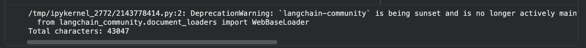

Printing the first 500 characters confirms the HTML was parsed into clean text: the title,
date, reading time and author come through, with no tags or page chrome.

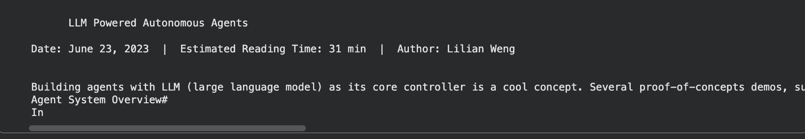

### Split

The document is cut into 63 chunks. The original tutorial reports 66; the count varies
slightly because the live blog page changes over time.

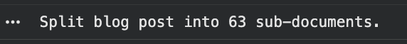

### Embed and store

Each chunk is embedded with Gemini and added to the vector store. `add_documents` returns
one ID per chunk, and the first three are printed. This completes indexing.

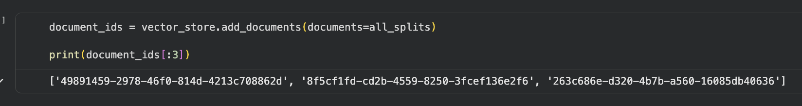

### Prompt

The RAG prompt has two slots, `{question}` and `{context}`. It tells the model to answer
only from the retrieved context and to say it doesn't know otherwise. It is defined inline
because `langchain.hub` was removed in LangChain 1.x, so no hub or LangSmith call is needed.
Filling the slots with placeholders shows the final text the model will receive.

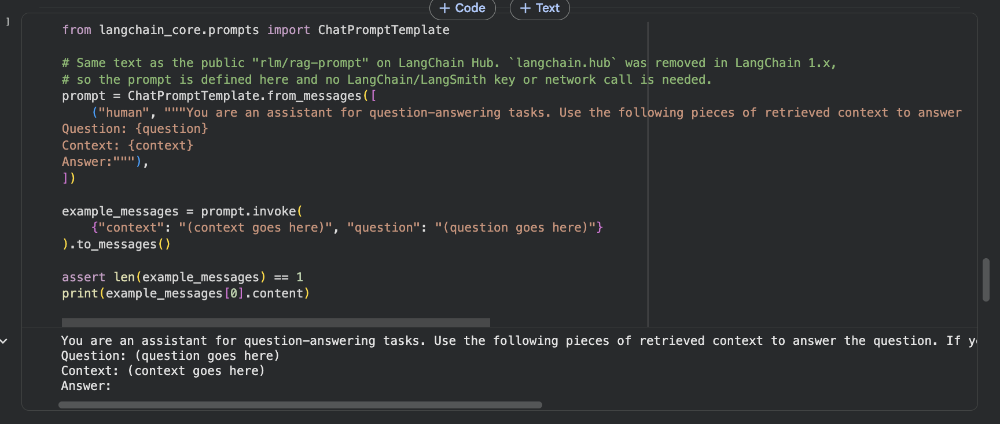

### LangGraph app

The app keeps a shared state (`question`, `context`, `answer`) and two steps: `retrieve`
and `generate`. LangGraph runs them in order, and the built-in diagram shows the flow:
`start` → `retrieve` → `generate` → `end`.

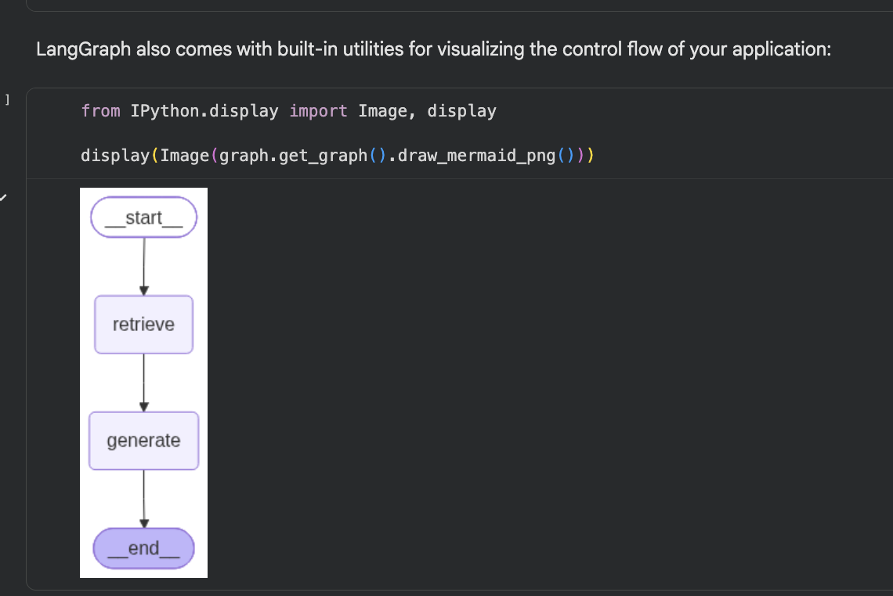

### Ask a question

`graph.invoke` runs the whole pipeline for "What is Task Decomposition?". The result holds
the retrieved chunks (`context`, each with its `source` and position in the post) and the
generated `answer`. Keeping the context in the state is what lets you cite sources.

The answer prints as a list of content blocks (`[{'type': 'text', 'text': ...}]`) because
the Gemini chat model returns structured content. The answer itself is the `text` field.

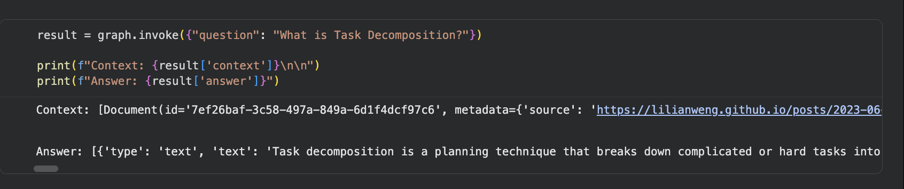

### Stream the steps

`graph.stream(..., stream_mode="updates")` yields each step's output as soon as it
finishes. You first see `retrieve` return the chunks, then `generate` return the answer,
which makes it easy to see where each piece comes from.

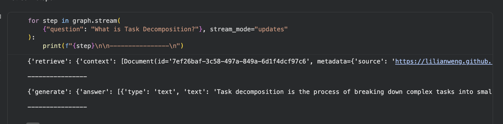

### Stream the tokens

`stream_mode="messages"` streams the model's output as it is generated, and the notebook
prints each piece followed by `|` so the chunk boundaries are visible. In this run the
answer arrived as a single block rather than word by word, so no `|` separators appear.
Streaming granularity depends on the model and the integration.

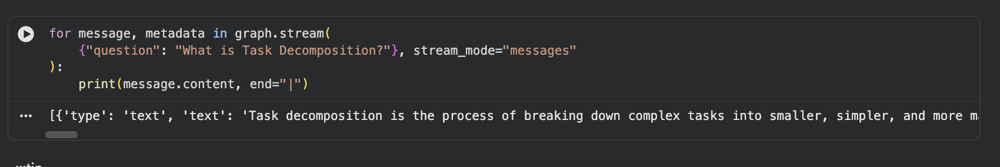

### Tag chunks with a section

To set up query analysis, each chunk gets a `section` label based on its position: the
first third is `beginning`, the next third `middle`, and the rest `end`. The first chunk's
metadata shows its `source`, its `start_index` in the original post and its new
`section`. The labels are contrived for the demo, but they give the LLM something to
filter on.

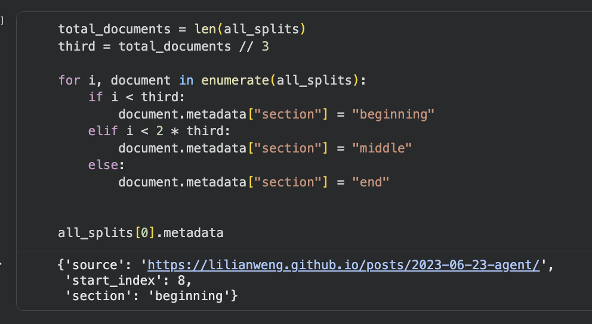

### Graph with query analysis

A new `analyze_query` step is added at the front. The LLM turns the user's question into a
structured `Search` (a `query` string plus a `section`), and `retrieve` uses it to filter
the chunks. The graph is now `start` → `analyze_query` → `retrieve` → `generate` → `end`,
one step longer than the first graph.

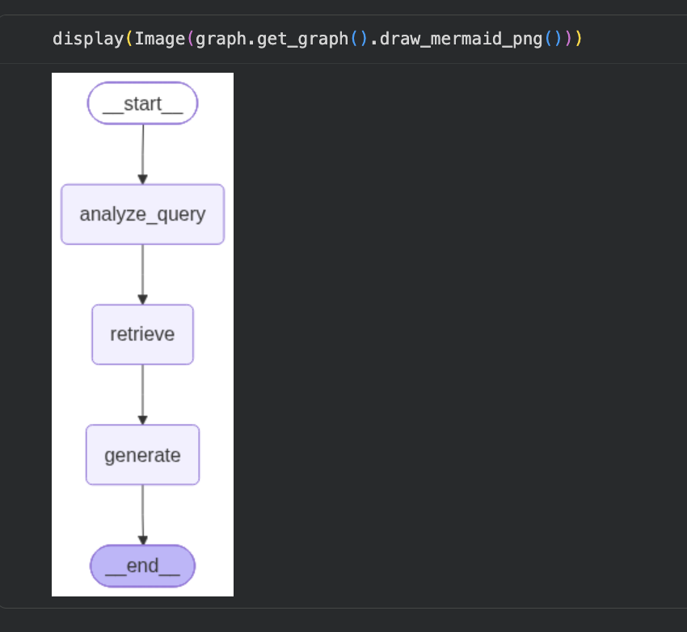

### Query analysis in action

Asking "What does the end of the post say about Task Decomposition?" streams all three steps:

1. `analyze_query` turns the question into `{'query': 'Task Decomposition', 'section': 'end'}`.
2. `retrieve` searches only the chunks tagged `section: end`.
3. `generate` answers from those chunks.

The structured query is exactly what we wanted, and the filter was applied. The final answer
in this run was "I don't know. The provided context does not mention Task Decomposition."
That is the prompt doing its job: the last third of the post, which is mostly case studies
and references, doesn't discuss task decomposition, and the model says so instead of
guessing. It also shows the trade-off of filtering. A narrow filter only helps if the
answer lives in that section, and the "sections" here are arbitrary thirds of the post.

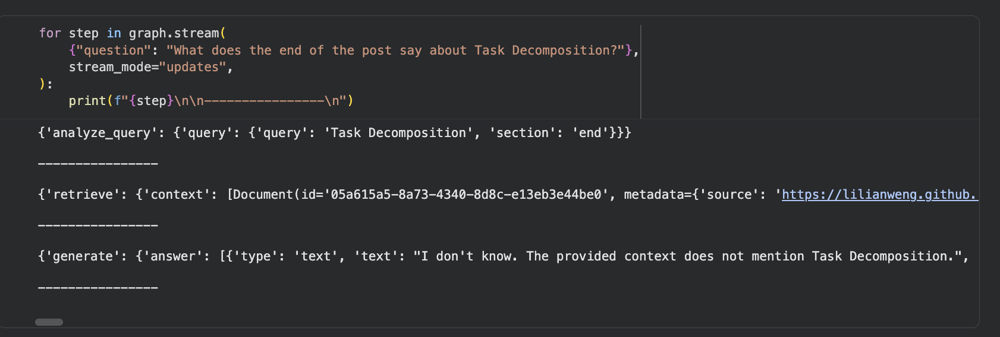

## Run it

1. Open `RagPart1.ipynb` in Google Colab.
2. Get a free Gemini key at https://aistudio.google.com/apikey.
3. Add it as a Colab secret named `GOOGLE_API_KEY` and turn on "Notebook access".
4. Run the cells in order. The first cell installs the dependencies. If pip asks for a restart, restart and run it again.

## Stack

LangChain, LangGraph, Google Gemini (chat and embeddings), BeautifulSoup.
